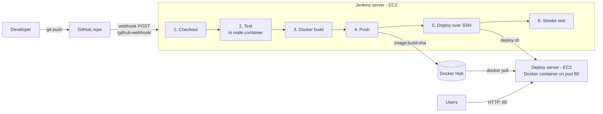

# End-to-End CI/CD Pipeline using Jenkins & Docker

A complete CI/CD pipeline. A **git push to GitHub** triggers **Jenkins** through a **webhook**. Jenkins runs the tests, builds a **Docker** image, pushes it to **Docker Hub**, and deploys it to an **AWS EC2** server, with an automatic health check and **rollback** if the new version is broken. No manual steps between commit and production.

   

---

## Architecture



**Before:** build the image by hand, copy files, restart the app (10+ minutes, easy to make mistakes).
**After:** `git push`, and about 2 minutes later the new version is live, tested and health-checked.

---

## Project structure

```
.
├── app/
│   ├── server.js            # Express app (/ and /health)
│   ├── server.test.js       # Unit tests (Node built-in test runner)
│   ├── package.json
│   ├── Dockerfile           # Alpine image, non-root user, HEALTHCHECK
│   └── .dockerignore
├── Jenkinsfile              # Declarative pipeline (6 stages)
├── scripts/
│   ├── deploy.sh            # Runs on the deploy server: pull, replace, health-check, rollback
│   └── setup-deploy-server.sh
├── jenkins/
│   └── install-jenkins.sh   # Installs Jenkins + Docker on Ubuntu EC2
├── docker-compose.yml       # Run locally
└── docs/interview-guide.md
```

---

## Pipeline stages

| # | Stage | What it does |
|---|---|---|
| 1 | Checkout | Clones the commit that triggered the build and creates the tag `<build>-<git-sha>` |
| 2 | Install & Test | Runs `npm test` inside a temporary `node:20-alpine` container, so Jenkins doesn't need Node installed |
| 3 | Build Image | `docker build` with two tags: the unique tag and `latest` |
| 4 | Push to Docker Hub | Logs in with Jenkins credentials (never hard-coded) and pushes both tags |
| 5 | Deploy to EC2 | SSHes to the server and runs `deploy.sh`: pull → replace container → wait for `healthy` → **roll back if unhealthy** |
| 6 | Smoke Test | `curl /health` from Jenkins, retried for up to 60s |
| post | Cleanup | Removes local images so the Jenkins disk doesn't fill up |

---

## Setup guide

### 1. Run locally (optional)
```bash
docker compose up --build
curl http://localhost:3000/health
```

### 2. Create two EC2 instances (Ubuntu, t2.micro/t3.small)
| Server | Security group inbound |
|---|---|
| Jenkins | 8080 from anywhere (UI + webhook), 22 from your IP |
| Deploy | 80 from anywhere, 22 from the Jenkins server |

### 3. Install Jenkins
```bash
scp jenkins/install-jenkins.sh ubuntu@<jenkins-ip>:~
ssh ubuntu@<jenkins-ip> 'sudo bash install-jenkins.sh'
```
Open `http://<jenkins-ip>:8080`, unlock it, and install the suggested plugins plus **SSH Agent**.

### 4. Prepare the deploy server
```bash
ssh ubuntu@<deploy-ip> 'curl -fsSL https://get.docker.com | sudo sh && sudo usermod -aG docker ubuntu'
```

### 5. Add Jenkins credentials
*Manage Jenkins → Credentials → Global:*
- `dockerhub-creds`: Username with password (use a Docker Hub **access token**)
- `deploy-ssh-key`: SSH username `ubuntu` + the private key of the deploy server

### 6. Create the pipeline job
New Item → **Pipeline** → *Pipeline script from SCM* → Git → your repo URL → Script Path `Jenkinsfile`.
Under *Build Triggers* tick **GitHub hook trigger for GITScm polling**.
Edit `DOCKERHUB_REPO` and `DEPLOY_HOST` at the top of the `Jenkinsfile`.

### 7. Add the GitHub webhook
GitHub repo → *Settings → Webhooks → Add webhook*
- Payload URL: `http://<jenkins-ip>:8080/github-webhook/` (the trailing slash matters)
- Content type: `application/json`
- Event: *Just the push event*

### 8. Test it
Change the message in `app/server.js`, commit and push. Jenkins starts within seconds; open `http://<deploy-ip>/` to see the new version.

---

## Key design decisions

- **Unique image tags** (`<build>-<sha>`) make every deployment traceable and easy to roll back.
- **Tests in a container:** the Jenkins server stays clean, and tests run in the same Node version every time.
- **Docker HEALTHCHECK + rollback script:** a broken release never stays live.
- **Credentials in the Jenkins credential store** are masked in logs and never committed to Git.
- **Non-root container user and Alpine base image** mean a smaller attack surface (about 50 MB image).
- **Layer caching:** `package.json` is copied before the source, so dependencies are only reinstalled when they change.
- `disableConcurrentBuilds()` stops two deployments from racing each other.

---

## Interview guide
See [docs/interview-guide.md](docs/interview-guide.md).
